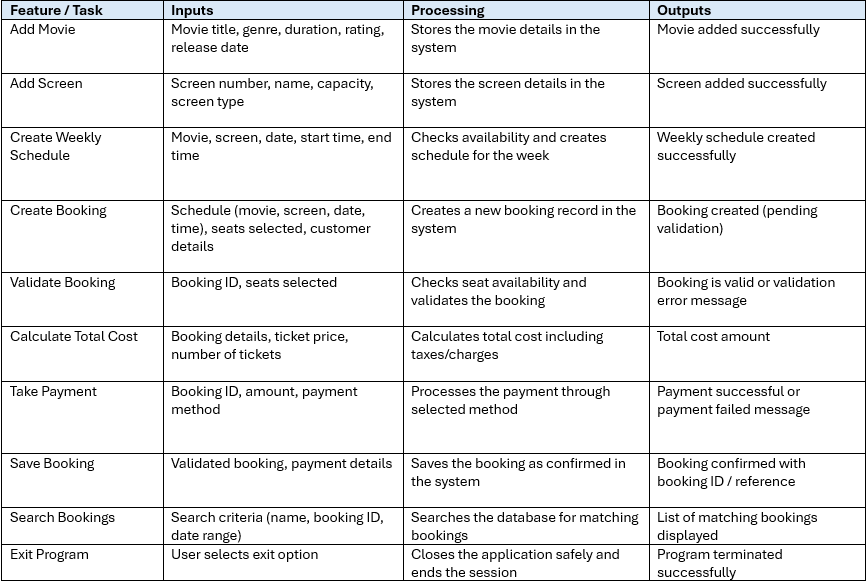
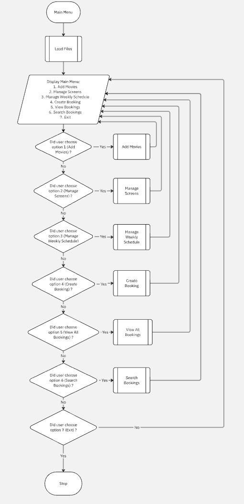
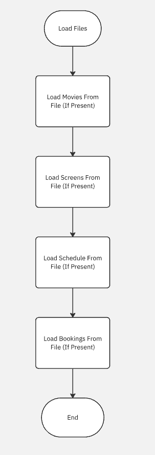
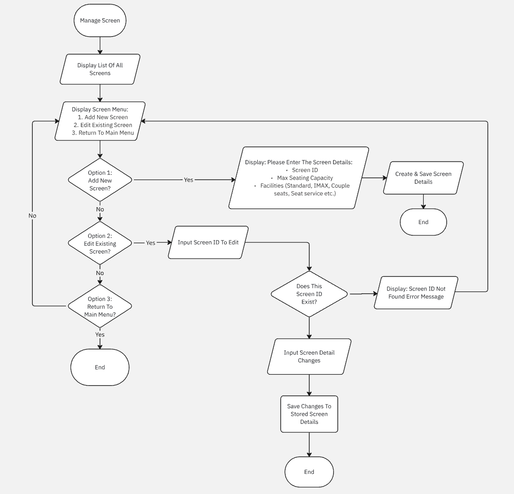
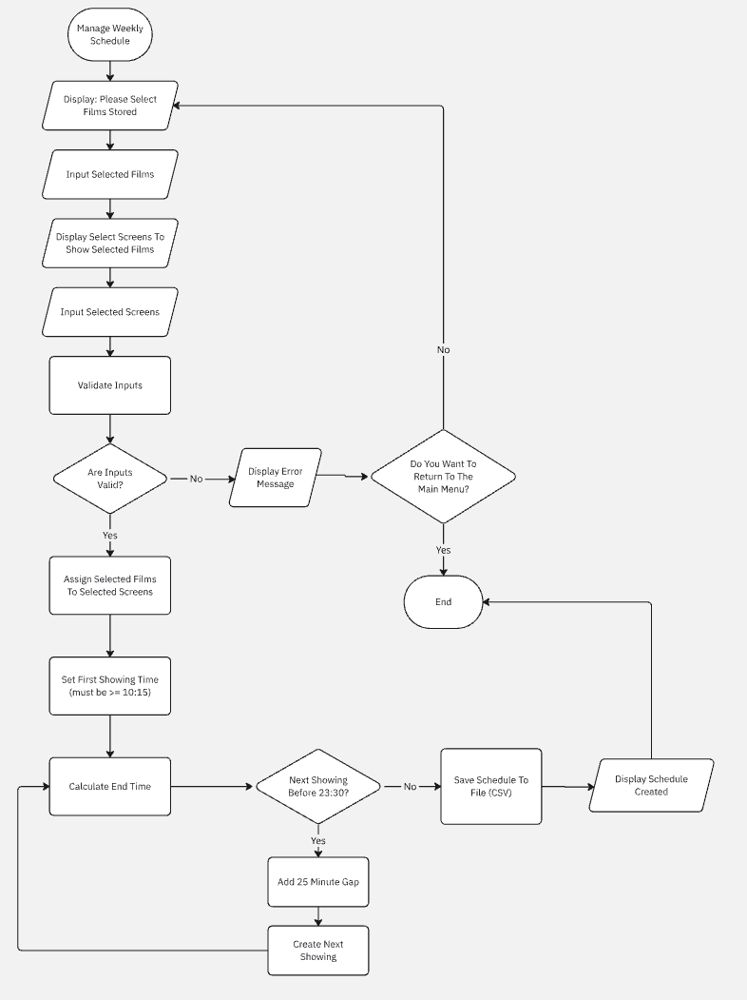
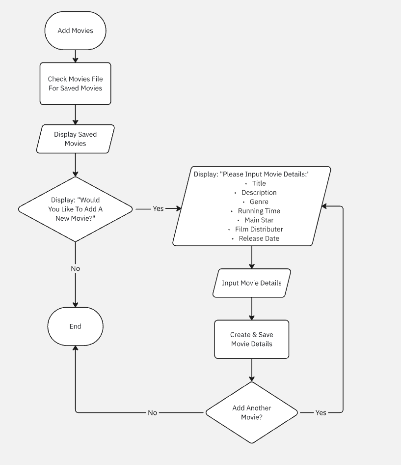
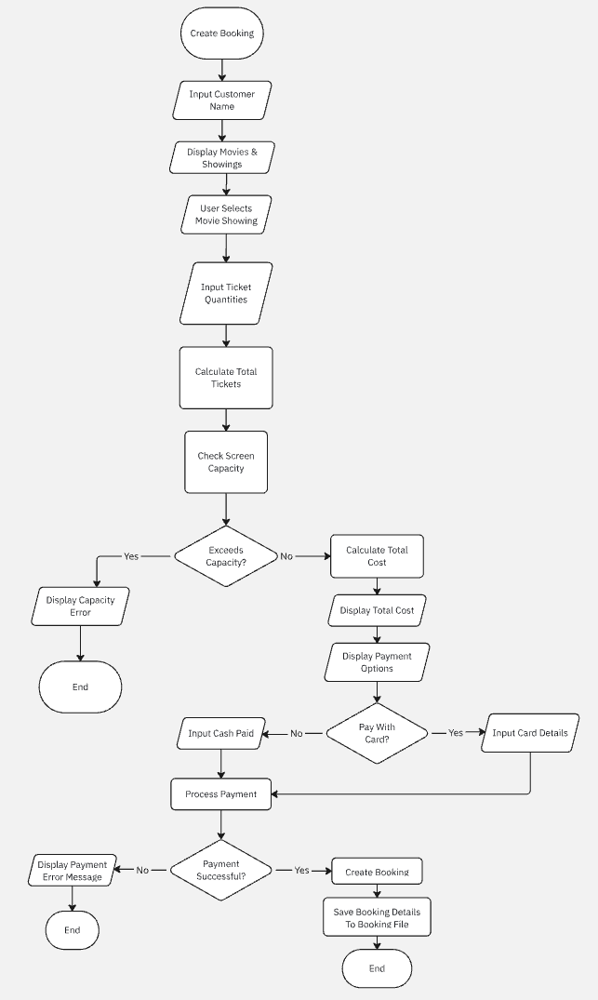
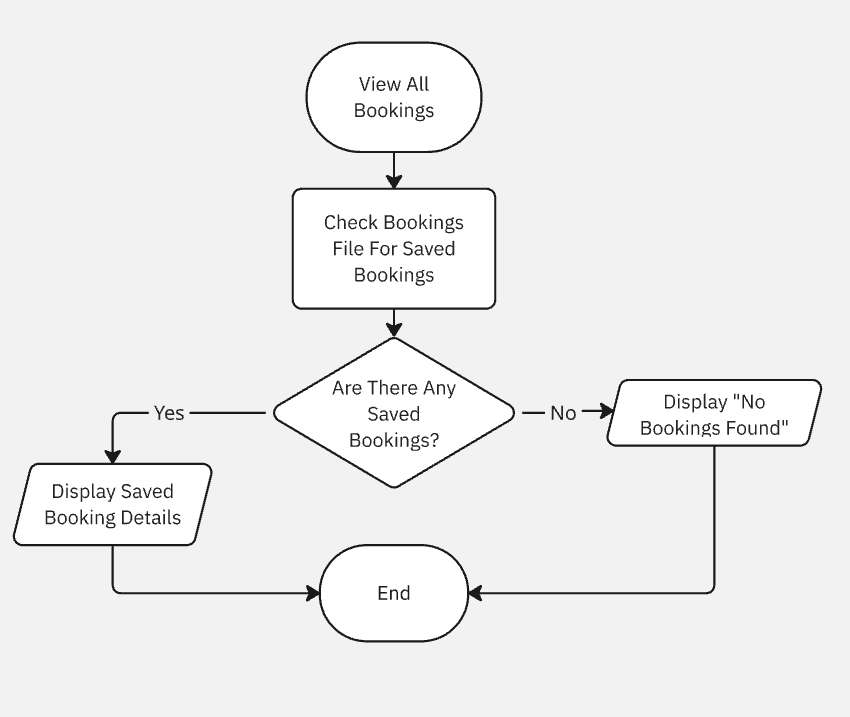
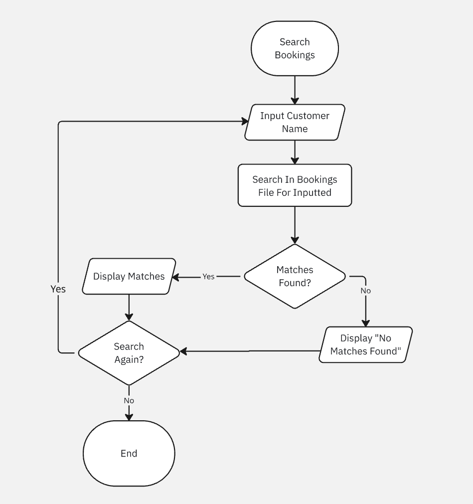

| Assessment Details | Please Complete All Details                                   |
| ------------------ | ------------------------------------------------------------- |
| Group              | A                                                             |
| Module Title       | IY453 Software Design and Implementation                      |
| Assessment Type    | IY453 Software Design and Implementation Coursework           |
| Module Tutor Name  | Jonathon Shore                                                |
| Student ID Number  | P466146                                                       |
| Date of Submission | 05/05/2026                                                    |
| Word Count         | 722                                                           |
| GitHub Link        | https://github.com/firasallawati/T0466146_453_Coursework_Real |

- [x] *I confirm that this assignment is my own work. Where I have referred to academic sources, I have provided in-text citations and included the sources in
  the final reference list.*

- [x] *Where I have used AI, I have cited and referenced appropriately.

---

### Purpose of the Program

---

The purpose of the program is to be designed for easy creation of ticket bookings by staff which can be used at the point of sale as well as making bookings of films for customers and managers can use to plan film showings one week in advance, the program will help in selecting a film, choosing a date and time, entering the required tickets, processing a payment (cash or card), as well as ensuring compliance with the rules of the cinema.

### **Core program functionality**

- **Create bookings**
  
  - Allow selecting a title from the list of movies offered and specifying the time when it is to be shown during the current week (Thursday to Wednesday).
  
  - Collecting customer details and the number of booked tickets for adults, children, students, and senior citizens.
  
  - Ensuring that the selected movie is to be shown according to its schedule and no more tickets can be sold than the seats available.
  
  - Computing the total booking cost using the set ticket prices.Collecting information about the chosen payment means and details of the payment process.
  
  - Capture the payment method (cash or card) and any required payment details.
  
  - Store the completed bookings in memory and save it to a bookings file so it can be viewed and searched later.
  
  **Manage movies**
  
  - Allow staff to add movie details such as title, description, genre, running time, main star, distributor, and release date.
  
  - Store movie details for later use in schedule creation and bookings.
  
  - Display the list of available movies so staff and managers can see which films can be scheduled and booked.
  
  **Manage screens**
  
  - Allow staff to enter details for each screen, including screen ID, maximum seating capacity, and facilities (Standard, IMAX, Couple seats, Seat service, etc.).
  
  - Store screen details so capacity checks and schedule creation can use this information to obey cinema rules.
  
  **Create weekly schedule**
  
  - Allow a manager to select the week to be scheduled (Thursday to Wednesday).
  
  - For each screen, allow the manager to select which film will be shown for that week.
  
  - Allow the manager to enter the start time of the first showing for each day, ensuring it does not start before 10:15.
  
  - For each showing, calculate the end time using the film’s running time and ensure the show does not end after the cinema closing time of 23:30.
  
  - Automatically enforce a 25‑minute gap between consecutive showings on the same screen for cleaning.
  
  - Store all schedule entries in memory and save them to a schedule file in text or CSV format.
  
  **View and search bookings**
  
  - Give an option for staff to view all stored bookings, showing customer name, film, date, time, ticket breakdown, and total cost.
  
  - Allow staff to search bookings by customer name, film title, or date, and show only the matching records.
  
  - Display clear confirmation messages when bookings are created successfully and informative error messages when input is invalid or a booking would overbook a screen.
  
  ---
  
  **System constraints (limitations / rules)**
  
  **Time and opening hours**
  
  - The cinema is open from 10:00 until 23:30 each day.
  
  - The earliest a film can be shown is 10:15, and no show may end after 23:30.
  
  - There must be a 25‑minute gap between the end of one showing and the start of the next showing in the same screen to allow for cleaning.
  
  **Weekly scope**
  
  - The system creates and manages schedules for one week at a time, from Thursday to Wednesday.
  
  - Staff can only make bookings for showings within the current Thursday–Wednesday week.
  
  **Capacity and tickets**
  
  - Each screen has a fixed maximum seating capacity that must not be exceeded when creating a booking.
  
  - Any booking that would exceed the screen’s capacity must be rejected.
  
  - Tickets are sold in four types only: adult, child, student, and senior citizen, each with a fixed ticket price.
  
  **Data storage and interface**
  
  - The program is a text‑based console application that uses menus and keyboard input.
  
  - Bookings and schedule data are stored in text or CSV files so that information is preserved between runs of the program.
  
  - Movie and screen information may initially be stored in memory, with file storage added as needed.
  
  **Scope exclusions**
  
  - The system does not manage staff accounts, user logins, or passwords.
  
  - It does not handle food, drink, or multiple cinema locations.
  
  - Card details are collected to process a transaction but are not stored permanently in any database.

---

### Input Process Output Table

---

---

### Algorithms

---

---

### **Testing**

**Test Table:**

| Test No. | Item to test                                                                                                                | Test description with example data                                                        | Expected result                                                 | Actual result                                                                        | Comments / Actions                                                                                                                    |
| -------- | --------------------------------------------------------------------------------------------------------------------------- | ----------------------------------------------------------------------------------------- | --------------------------------------------------------------- | ------------------------------------------------------------------------------------ | ------------------------------------------------------------------------------------------------------------------------------------- |
| 1        | `Booking::SetCustomerName(string customer_name)`                                                                            | Valid Case: Enter customer name "Adam Khan" when prompted for booking details             | Adam Khan is stored correctly in the booking object             | Pass - customer name stored correctly                                                | No comment                                                                                                                            |
| 2        | `Booking::SetCustomerName(string customer_name)`                                                                            | Valid Case: Enter customer name "Sara O'Brien" when prompted for booking details          | Name with punctuation is accepted and stored correctly          | Pass - punctuation accepted correctly                                                | No comment                                                                                                                            |
| 3        | `Booking::SetCustomerName(string customer_name)`                                                                            | Invalid Case: Enter blank customer name when prompted for booking details                 | Blank input is rejected and user is asked again                 | Pass - Blank input rejected, user prompted to try again                              | No comment                                                                                                                            |
| 4        | `Booking::SetCustomerName(string customer_name)`                                                                            | Edge Case: Enter long customer name "Christopher Jonathan Williams-Brown"                 | Long name is accepted or handled safely without crashing        | Pass - long input handled safely                                                     | No comment                                                                                                                            |
| 5        | `Booking::SetMovie(Movie movie)`                                                                                            | Valid Case: Select movie title "Inside Out 2" from the available movie list               | Selected movie is stored in the booking correctly               | Pass - movie stored correctly                                                        | No comment                                                                                                                            |
| 6        | `Booking::SetMovie(Movie movie)`                                                                                            | Valid Case: Select movie title "Dune: Part Two" from the available movie list             | Selected movie is stored and displayed correctly                | Pass - second movie stored correctly                                                 | No comment                                                                                                                            |
| 7        | `Booking::SetMovie(Movie movie)`                                                                                            | Invalid Case: Enter invalid movie option "99" when choosing from the menu                 | Invalid selection is rejected and user is prompted again        | Pass - invalid menu choice rejected                                                  | No comment                                                                                                                            |
| 8        | `Booking::SetMovie(Movie movie)`                                                                                            | Invalid Case: Enter text "abc" instead of a movie choice number                           | Program handles invalid input and re-prompts safely             | Pass - invalid text input handled correctly                                          | No comment                                                                                                                            |
| 9        | `Booking::SetBookingDate(string booking_date)`                                                                              | Valid Case: Enter valid booking day "Thursday"                                            | Booking day is accepted and stored correctly                    | Pass - valid booking day stored correctly                                            | No comment                                                                                                                            |
| 10       | `Booking::SetBookingDate(string booking_date)`                                                                              | Valid Case: Enter valid booking day "Wednesday"                                           | Booking day is accepted and stored correctly                    | Pass - Wednesday accepted correctly                                                  | No comment                                                                                                                            |
| 11       | `Booking::SetBookingDate(string booking_date)`                                                                              | Invalid Case: Enter invalid day "Funday"                                                  | Invalid day is rejected and user is asked again                 | Pass- invalid day rejected                                                           | No comment                                                                                                                            |
| 12       | `Booking::SetBookingDate(string booking_date)`                                                                              | Edge Case: Enter blank day input ""                                                       | Blank day is rejected                                           | Pass - blank day rejected                                                            | No comment                                                                                                                            |
| 13       | `Booking::SetBookingTime(string booking_time)`                                                                              | Valid Case: Enter valid time "14:30"                                                      | Time is accepted and stored correctly                           | Pass - valid time stored correctly                                                   | No comment                                                                                                                            |
| 14       | `Booking::SetBookingTime(string booking_time)`                                                                              | Valid Case: Enter valid time "19:00"                                                      | Time is accepted and stored correctly                           | Pass - second valid time stored correctly                                            | No comment                                                                                                                            |
| 15       | `Booking::SetBookingTime(string booking_time)`                                                                              | Invalid Case: Enter invalid time "09:00"                                                  | Time is rejected because it is before the earliest showing time | Pass - Invalid time rejected.                                                        | No comment                                                                                                                            |
| 16       | `Booking::SetBookingTime(string booking_time)`                                                                              | Invalid Case: Enter invalid time format "25:99"                                           | Invalid time format is rejected                                 | Pass - invalid time format rejected                                                  | No comment                                                                                                                            |
| 17       | `Booking::SetAdultTickets(int adult_tickets)` and related ticket setters                                                    | Valid Case: Enter "2" adult, "1" child, "1" student, "0" senior                           | Ticket quantities are stored correctly                          | Pass - ticket quantities stored correctly                                            | No comment                                                                                                                            |
| 18       | `Booking::GetTotalTickets()`                                                                                                | Invalid Case: Enter "0" adult, "0" child, "0" student, "0" senior                         | Booking should not continue with zero tickets                   | Pass - zero-ticket booking rejected                                                  | No comment                                                                                                                            |
| 19       | `Booking::SetAdultTickets(int adult_tickets)` and related ticket setters                                                    | Invalid Case: Enter "-1" adult, "0" child, "0" student, "0" senior                        | Negative quantity is rejected                                   | Pass - negative ticket quantity rejected                                             | No comment                                                                                                                            |
| 20       | `Booking::GetTotalTickets()`                                                                                                | Edge Case: Enter "260" total tickets for a screen with "250" seats                        | Booking is rejected because capacity is exceeded                | Pass - over-capacity booking rejected                                                | No comment                                                                                                                            |
| 21       | `PaymentDetails::SetPaymentMethod(string payment_method)`                                                                   | Valid Case: Enter payment method "Card"                                                   | Payment method is accepted and stored as card                   | Pass - card payment method accepted                                                  | No comment                                                                                                                            |
| 22       | `PaymentDetails::SetPaymentMethod(string payment_method)`                                                                   | Valid Case: Enter payment method "Cash"                                                   | Payment method is accepted and stored as cash                   | Pass - cash payment method accepted                                                  | No comment                                                                                                                            |
| 23       | `PaymentDetails::SetPaymentMethod(string payment_method)`                                                                   | Valid Case: Enter payment method "card"                                                   | Payment method is normalised and accepted                       | Pass - lowercase card accepted correctly                                             | No comment                                                                                                                            |
| 24       | `PaymentDetails::SetPaymentMethod(string payment_method)`                                                                   | Invalid Case: Enter invalid method "bank transfer"                                        | Invalid payment method is rejected                              | Pass - invalid payment method rejected                                               | No comment                                                                                                                            |
| 25       | `PaymentDetails::SetCardNumber(string card_number)`, `SetCvcNumber(string cvc_number)`, `SetExpiryDate(string expiry_date)` | Valid Case: Enter "1234567812345678", "123", "12/27"                                      | Card payment details are accepted correctly                     | Pass - valid card details accepted                                                   | No comment                                                                                                                            |
| 26       | `PaymentDetails::SetCardNumber(string card_number)`                                                                         | Invalid Case: Enter short card number "1234"                                              | Invalid card number is rejected                                 | Fail - short card number accepted                                                    | Add length validation for card number                                                                                                 |
| 27       | `PaymentDetails::SetCvcNumber(string cvc_number)`                                                                           | Invalid Case: Enter invalid CVC "12"                                                      | Invalid CVC is rejected                                         | Fail - short CVC accepted                                                            | Add 3-digit validation for CVC                                                                                                        |
| 28       | `PaymentDetails::SetExpiryDate(string expiry_date)`                                                                         | Invalid Case: Enter blank expiry date ""                                                  | Blank expiry date is rejected                                   | Fail - blank expiry date accepted                                                    | Add non-empty expiry date validation                                                                                                  |
| 29       | `PaymentDetails::SetCashPaid(double cash_paid)`                                                                             | Valid Case: Enter cash paid "24.50" for total cost "24.50"                                | Payment is accepted exactly                                     | Pass - exact cash payment accepted                                                   | No comment                                                                                                                            |
| 30       | `PaymentDetails::SetCashPaid(double cash_paid)`                                                                             | Invalid Case: Enter cash paid "20.00" for total cost "24.50"                              | Payment is rejected because it is too low                       | Pass - payment rejected                                                              | No comment                                                                                                                            |
| 31       | `PaymentDetails::SetCashPaid(double cash_paid)`                                                                             | Edge Case: Enter cash paid "30.00" for total cost "24.50"                                 | Payment is accepted and change can be calculated                | Fail - overpayment accepted correctly but no change has been calculated or displayed | Add change calculation and display to user.                                                                                           |
| 32       | `PaymentDetails::SetCashPaid(double cash_paid)`                                                                             | Invalid Case: Enter text "ten pounds" instead of a number                                 | Invalid numeric input is rejected safely                        | Pass - non-numeric input handled correctly                                           | No comment                                                                                                                            |
| 33       | Search by customer name using `Booking::GetCustomerName()`                                                                  | Valid Case: Search "Adam Khan"                                                            | Matching booking(s) are displayed                               | Pass - booking found by customer name                                                | No comment                                                                                                                            |
| 34       | Search by customer name using `Booking::GetCustomerName()`                                                                  | Valid Case: Search "Sara O'Brien"                                                         | Matching booking(s) are displayed                               | Pass - second customer search worked                                                 | No comment                                                                                                                            |
| 35       | Search by customer name using `Booking::GetCustomerName()`                                                                  | Invalid Case: Search "ZZZ Test"                                                           | No results message is shown                                     | Pass - no results returned                                                           | No comment                                                                                                                            |
| 36       | Search by customer name using `Booking::GetCustomerName()`                                                                  | Edge Case: Enter blank search input ""                                                    | Blank search is rejected                                        | Pass - blank search rejected                                                         | No comment                                                                                                                            |
| 37       | Search by film title using `Movie::GetTitle()`                                                                              | Valid Case: Search "Inside Out 2"                                                         | Matching booking(s) are displayed                               | Pass - film title search worked                                                      | No comment                                                                                                                            |
| 38       | Search by film title using `Movie::GetTitle()`                                                                              | Valid Case: Search "Dune: Part Two"                                                       | Matching booking(s) are displayed                               | Pass - second film title search worked                                               | No comment                                                                                                                            |
| 39       | Search by film title using `Movie::GetTitle()`                                                                              | Invalid Case: Search "Fake Movie"                                                         | No results message is shown                                     | Pass - no matching film found                                                        | No comment                                                                                                                            |
| 40       | Search by film title using `Movie::GetTitle()`                                                                              | Edge Case: Search "inside out 2" using lowercase                                          | Search behaves consistently or matches case-insensitively       | Fail - case-sensitive mismatch                                                       | Consider improving validation of lowercase strings                                                                                    |
| 41       | Search by date/day using `Booking::GetBookingDate()`                                                                        | Valid Case: Search "Thursday"                                                             | Matching bookings are displayed                                 | Pass - booking found by day                                                          | No comment                                                                                                                            |
| 42       | Search by date/day using `Booking::GetBookingDate()`                                                                        | Valid Case: Search "Wednesday"                                                            | Matching bookings are displayed                                 | Pass - second date/day search worked                                                 | No comment                                                                                                                            |
| 43       | Search by date/day using `Booking::GetBookingDate()`                                                                        | Invalid Case: Search "Sunday" when no booking exists                                      | No results message is shown                                     | Pass - no bookings found for that day                                                | No comment                                                                                                                            |
| 44       | Search by date/day using `Booking::GetBookingDate()`                                                                        | Invalid Case: Enter invalid value "Funday"                                                | Invalid search input is rejected                                | Pass - invalid date/day search rejected                                              | No comment                                                                                                                            |
| 45       | `MovieSchedule::SetScreenId(string screen_id)`                                                                              | Valid Case: Enter screen ID "1"                                                           | Screen ID is stored correctly                                   | Pass - screen 1 accepted                                                             | No comment                                                                                                                            |
| 46       | `MovieSchedule::SetScreenId(string screen_id)`                                                                              | Valid Case: Enter screen ID "5"                                                           | Screen ID is stored correctly                                   | Pass - screen 5 accepted                                                             | No comment                                                                                                                            |
| 47       | `MovieSchedule::SetScreenId(string screen_id)`                                                                              | Invalid Case: Enter invalid screen ID "0"                                                 | Invalid screen ID is rejected                                   | Pass - screen 0 rejected                                                             | No comment                                                                                                                            |
| 48       | `MovieSchedule::SetScreenId(string screen_id)`                                                                              | Invalid Case: Enter out-of-range screen ID "10"                                           | Invalid screen ID is rejected                                   | Pass - screen 10 rejected                                                            | No comment                                                                                                                            |
| 49       | `MovieSchedule::SetMovieTitle(string movie_title)`                                                                          | Valid Case: Enter movie title "Inside Out 2"                                              | Movie title is stored correctly                                 | Pass - schedule movie stored correctly                                               | No comment                                                                                                                            |
| 50       | `MovieSchedule::SetMovieTitle(string movie_title)`                                                                          | Valid Case: Enter movie title "Dune: Part Two"                                            | Movie title is stored correctly                                 | Pass - second scheduled movie stored correctly                                       | No comment                                                                                                                            |
| 51       | `MovieSchedule::SetMovieTitle(string movie_title)`                                                                          | Invalid Case: Enter fake movie title "Fake Movie"                                         | Invalid movie title is rejected                                 | Fail - non-listed movie accepted                                                     | Adding validation will require a huge data base to compare added movies to real movies, which is way beyond the scope of the project. |
| 52       | `MovieSchedule::SetMovieTitle(string movie_title)`                                                                          | Edge Case: Enter blank title ""                                                           | Blank title is rejected                                         | Pass - blank title rejected                                                          | No comment                                                                                                                            |
| 53       | `MovieSchedule::SetDay(string day)` and `SetDate(string date)`                                                              | Valid Case: Enter "Thursday", "2026-06-18"                                                | Schedule day and date are stored correctly                      | Pass - valid schedule day/date stored                                                | No comment                                                                                                                            |
| 54       | `MovieSchedule::SetDay(string day)` and `SetDate(string date)`                                                              | Valid Case: Enter "Monday", "2026-06-22"                                                  | Schedule day and date are stored correctly                      | Pass - second valid schedule entry stored                                            | No comment                                                                                                                            |
| 55       | `MovieSchedule::SetDay(string day)` and `SetDate(string date)`                                                              | Invalid Case: Enter "Friday", "2026-06-26" outside the correct schedule week              | Invalid schedule date is rejected                               | Fail - out of range date accepted                                                    | Add validation for date range                                                                                                         |
| 56       | `MovieSchedule::SetDay(string day)` and `SetDate(string date)`                                                              | Invalid Case: Enter invalid day "Funday" with date "2026-06-22"                           | Invalid day/date is rejected                                    | Pass - invalid day rejected                                                          | Add validation for date range                                                                                                         |
| 57       | `MovieSchedule::SetStartTime(string start_time)` and `SetEndTime(string end_time)`                                          | Valid Case: Enter "10:15" to "12:00"                                                      | Start and end times are stored correctly                        | Pass - valid schedule time stored                                                    | No comment                                                                                                                            |
| 58       | `MovieSchedule::SetStartTime(string start_time)` and `SetEndTime(string end_time)`                                          | Valid Case: Enter "19:00" to "21:30"                                                      | Start and end times are stored correctly                        | Pass - second valid schedule time stored                                             | No comment                                                                                                                            |
| 59       | `MovieSchedule::SetStartTime(string start_time)` and `SetEndTime(string end_time)`                                          | Invalid Case: Enter "14:00" to "13:00"                                                    | End time must be later than start time                          | Pass - invalid time order rejected                                                   | No comment                                                                                                                            |
| 60       | `MovieSchedule::SetStartTime(string start_time)` and `SetEndTime(string end_time)`                                          | Invalid Case: Enter "22:30" to "23:45"                                                    | Time slot is rejected because it exceeds closing time           | Pass - late schedule rejected                                                        | No comment                                                                                                                            |
| 61       | File save feature for bookings                                                                                              | Valid Case: Save booking "Adam Khan", "Inside Out 2", "Thursday", "14:30" to bookings.csv | Booking data is saved successfully                              | Pass - booking saved successfully                                                    | No comment                                                                                                                            |
| 62       | File load feature for bookings and schedules                                                                                | Valid Case: Load previously saved data from bookings.csv and schedules.csv                | Saved data loads correctly                                      | Pass - data loaded correctly                                                         | No comment                                                                                                                            |
| 63       | File load feature for missing file                                                                                          | Invalid Case: Try loading missing.csv                                                     | Program shows safe error message and continues                  | Pass - missing file handled safely                                                   | No comment                                                                                                                            |
| 64       | File persistence check                                                                                                      | Edge Case: Save several records, restart program, load the files again                    | Previously saved records remain available                       | Pass - persistence confirmed                                                         | No comment                                                                                                                            |

---

**Annotation Screenshots:**

---

**Techincal Elements:**

---

### **Refrences**

[How to check if a string value is in a correct time format using c++](https://stackoverflow.com/questions/49972344/how-to-check-if-a-string-value-is-in-a-correct-time-format-using-c "https://stackoverflow.com/questions/49972344/how-to-check-if-a-string-value-is-in-a-correct-time-format-using-c")

Check Valid Time

[C++ iostream cin object](https://www.w3schools.com/cpp/ref_iostream_cin.asp "https://www.w3schools.com/cpp/ref_iostream_cin.asp")

Buffer Clear

[C++ Files](https://www.w3schools.com/cpp/cpp_files.asp)

File Handling if/ofstream

25 min gap

---

### Appendix Code

---

**main.cpp**

#include <iostream>  
#include <vector>  
#include "movie.h"  
#include "screen.h"  
#include "payment_details.h"  
#include "booking.h"  
#include "booking_manager.h"  
#include "movie_schedule.h"  
#include "schedule_manager.h"  
#include "input_handler.h"  

using namespace std;  

double CalculateBookingCost(int adult_tickets, int child_tickets, int student_tickets, int senior_tickets) {  
    return (adult_tickets * 9.50) +  
           (child_tickets * 5.50) +  
           (student_tickets * 7.00) +  
           (senior_tickets * 6.50);  
}  

void DisplayBookingResults(const vector<Booking>& bookings) {  
    if (bookings.empty()) {  
        cout << "No matching bookings found." << endl;  
        return;  
    }  

for (int i = 0; i < bookings.size(); i++) {  
    cout << "Result " << i + 1 << ":" << endl;  
    bookings[i].DisplayBooking();  
    cout << endl;  
}  

}  

int main() {  
    BookingManager booking_manager;  
    ScheduleManager schedule_manager;  

vector<Screen> screens;  
screens.push_back(Screen("Screen 1", "No Movie", 250, 250, "IMAX"));  
screens.push_back(Screen("Screen 2", "No Movie", 200, 200, "Standard"));  
screens.push_back(Screen("Screen 3", "No Movie", 180, 180, "Couple Seats"));  
screens.push_back(Screen("Screen 4", "No Movie", 150, 150, "Seat Service"));  
screens.push_back(Screen("Screen 5", "No Movie", 100, 100, "Standard"));  

int choice = 0;  

while (choice != 8) {  
    cout << endl;  
    cout << "     Cinema Booking System   " << endl;  
    cout << "1. Add Booking" << endl;  
    cout << "2. View All Bookings" << endl;  
    cout << "3. Search Bookings" << endl;  
    cout << "4. Add Schedule" << endl;  
    cout << "5. View All Schedules" << endl;  
    cout << "6. Save Data" << endl;  
    cout << "7. Load Data" << endl;  
    cout << "8. Exit" << endl;  

choice = InputHandler::GetIntInRange("Enter choice: ", 1, 8);  

if (choice == 1) {  
    string customer_name = InputHandler::GetNonEmptyString("Enter customer name: ");  
    string movie_title = InputHandler::GetNonEmptyString("Enter movie title: ");  
    string booking_day = InputHandler::GetValidDay("Enter booking day (Thursday to Wednesday): ");  
    string booking_time = InputHandler::GetValidTime("Enter booking time (HH:MM): ");  

int adult_tickets = InputHandler::GetNonNegativeInt("Enter number of adult tickets: ");  
int child_tickets = InputHandler::GetNonNegativeInt("Enter number of child tickets: ");  
int student_tickets = InputHandler::GetNonNegativeInt("Enter number of student tickets: ");  
int senior_tickets = InputHandler::GetNonNegativeInt("Enter number of senior tickets: ");  

while (adult_tickets + child_tickets + student_tickets + senior_tickets == 0) {  
    cout << "At least one ticket must be booked." << endl;  
    adult_tickets = InputHandler::GetNonNegativeInt("Enter number of adult tickets: ");  
    child_tickets = InputHandler::GetNonNegativeInt("Enter number of child tickets: ");  
    student_tickets = InputHandler::GetNonNegativeInt("Enter number of student tickets: ");  
    senior_tickets = InputHandler::GetNonNegativeInt("Enter number of senior tickets: ");  
}  

cout << "Choose a screen:" << endl;  
for (int i = 0; i < screens.size(); i++) {  
    cout << i + 1 << ". "  
         << screens[i].GetScreenId()  
         << " | Available Seats: " << screens[i].GetAvailableSeats()  
         << " | Facilities: " << screens[i].GetFacilities()  
         << endl;  
}  

int screen_choice = InputHandler::GetIntInRange("Enter screen number: ", 1, screens.size());  

int total_tickets = adult_tickets + child_tickets + student_tickets + senior_tickets;  
while (total_tickets > screens[screen_choice - 1].GetAvailableSeats()) {  
    cout << "Not enough seats available on this screen." << endl;  
    cout << "Available seats: " << screens[screen_choice - 1].GetAvailableSeats() << endl;  

    adult_tickets = InputHandler::GetNonNegativeInt("Re-enter number of adult tickets: ");  
    child_tickets = InputHandler::GetNonNegativeInt("Re-enter number of child tickets: ");  
    student_tickets = InputHandler::GetNonNegativeInt("Re-enter number of student tickets: ");  
    senior_tickets = InputHandler::GetNonNegativeInt("Re-enter number of senior tickets: ");  

    total_tickets = adult_tickets + child_tickets + student_tickets + senior_tickets;  
}  

double total_cost = CalculateBookingCost(adult_tickets, child_tickets, student_tickets, senior_tickets);  
cout << "Total booking cost: " << total_cost << endl;  

string payment_method = InputHandler::GetValidPaymentMethod("Enter payment method (Cash/Card): ");  

PaymentDetails payment_details;  
payment_details.SetPaymentMethod(payment_method);  

if (payment_method == "Card") {  
    string card_number = InputHandler::GetNonEmptyString("Enter card number: ");  
    string cvc_number = InputHandler::GetNonEmptyString("Enter CVC number: ");  
    string expiry_date = InputHandler::GetNonEmptyString("Enter expiry date: ");  

    payment_details.SetCardNumber(card_number);  
    payment_details.SetCvcNumber(cvc_number);  
    payment_details.SetExpiryDate(expiry_date);  
} else {  
    double cash_paid = InputHandler::GetDoubleAtLeast("Enter cash paid: ", total_cost);  
    payment_details.SetCashPaid(cash_paid);  
}  

Movie movie;  
movie.SetTitle(movie_title);  

Booking booking(  
    customer_name,  
    movie,  
    booking_day,  
    booking_time,  
    adult_tickets,  
    child_tickets,  
    student_tickets,  
    senior_tickets,  
    total_cost,  
    payment_details  
);  

if (booking_manager.CanAddBooking(screens[screen_choice - 1], booking)) {  
    booking_manager.AddBooking(booking);  

    int updated_seats = screens[screen_choice - 1].GetAvailableSeats() - booking.GetTotalTickets();  
    screens[screen_choice - 1].SetAvailableSeats(updated_seats);  
    screens[screen_choice - 1].SetCurrentMovie(movie_title);  

    cout << "Booking added successfully." << endl;  
} else {  
    cout << "Booking could not be added. Check booking rules or screen capacity." << endl;  
}  

}  

else if (choice == 2) {  
    booking_manager.DisplayAllBookings();  
}  

else if (choice == 3) {  
    cout << "Search bookings by:" << endl;  
    cout << "1. Customer name" << endl;  
    cout << "2. Movie title" << endl;  
    cout << "3. Date/Day" << endl;  

int search_choice = InputHandler::GetIntInRange("Enter choice: ", 1, 3);  
if (search_choice == 1) {  
    string customer_name = InputHandler::GetNonEmptyString("Enter customer name: ");  
    DisplayBookingResults(booking_manager.SearchByCustomerName(customer_name));  
} else if (search_choice == 2) {  
    string movie_title = InputHandler::GetNonEmptyString("Enter movie title: ");  
    DisplayBookingResults(booking_manager.SearchByMovieTitle(movie_title));  
} else {  
    string booking_date = InputHandler::GetNonEmptyString("Enter date/day: ");  
    DisplayBookingResults(booking_manager.SearchByDate(booking_date));  
}  

}  

else if (choice == 4) {  
    string screen_id = InputHandler::GetNonEmptyString("Enter screen ID: ");  
    string movie_title = InputHandler::GetNonEmptyString("Enter movie title: ");  
    string day = InputHandler::GetValidDay("Enter day: ");  
    string date = InputHandler::GetNonEmptyString("Enter date: ");  
    string start_time = InputHandler::GetValidTime("Enter start time (HH:MM): ");  
    string end_time = InputHandler::GetValidEndTimeAfterStart("Enter end time (HH:MM): ", start_time);  

MovieSchedule schedule(screen_id, movie_title, day, date, start_time, end_time);  
if (schedule_manager.CanAddSchedule(schedule)) {  
    schedule_manager.AddSchedule(schedule);  
    cout << "Schedule added successfully." << endl;  
} else {  
    cout << "Schedule could not be added. Check schedule overlap or 25-minute gap." << endl;  
}  

}  

else if (choice == 5) {  
    schedule_manager.DisplayAllSchedules();  
}  

else if (choice == 6) {  
    booking_manager.SaveBookingsToFile("bookings.csv");  
    schedule_manager.SaveSchedulesToFile("schedules.csv");  
    cout << "Data saved successfully." << endl;  
}  

else if (choice == 7) {  
    booking_manager.LoadBookingsFromFile("bookings.csv");  
    schedule_manager.LoadSchedulesFromFile("schedules.csv");  
    cout << "Data loaded successfully." << endl;  
}  

else if (choice == 8) {  
    cout << "Exiting program." << endl;  
}  

}  

return 0;  

**movie.h**

#ifndef T0466146_453_COURSEWORK_REAL_MOVIE_H  
#define T0466146_453_COURSEWORK_REAL_MOVIE_H  

#include <iostream>  
#include <string>  
using namespace std;  

class Movie {  
private:  
    string title_;  
    string description_;  
    string genre_;  
    string certificate_;  
    int running_time_;  
    string main_star_;  
    string distributor_;  
    string release_date_;  

public:  
    Movie();  
    Movie(string title, string description, string genre, string certificate,  
          int running_time, string main_star, string distributor, string release_date);  

string GetTitle() const;  
string GetDescription() const;  
string GetGenre() const;  
string GetCertificate() const;  
int GetRunningTime() const;  
string GetMainStar() const;  
string GetDistributor() const;  
string GetReleaseDate() const;  

void SetTitle(string title);  
void SetDescription(string description);  
void SetGenre(string genre);  
void SetCertificate(string certificate);  
void SetRunningTime(int running_time);  
void SetMainStar(string main_star);  
void SetDistributor(string distributor);  
void SetReleaseDate(string release_date);  

void DisplayMovie() const;  

};  

#endif //T0466146_453_COURSEWORK_REAL_MOVIE_H

**movie.cpp**

#include <iostream>  
#include "movie.h"  

using namespace std;  

Movie::Movie() {  
    title_ = "";  
    description_ = "";  
    genre_ = "";  
    certificate_ = "";  
    running_time_ = 0;  
    main_star_ = "";  
    distributor_ = "";  
    release_date_ = "";  
}  

Movie::Movie(string title, string description, string genre, string certificate,  
             int running_time, string main_star, string distributor, string release_date) {  
    title_ = title;  
    description_ = description;  
    genre_ = genre;  
    certificate_ = certificate;  
    running_time_ = running_time;  
    main_star_ = main_star;  
    distributor_ = distributor;  
    release_date_ = release_date;  
}  

string Movie::GetTitle() const {  
    return title_;  
}  

string Movie::GetDescription() const {  
    return description_;  
}  

string Movie::GetGenre() const {  
    return genre_;  
}  

string Movie::GetCertificate() const {  
    return certificate_;  
}  

int Movie::GetRunningTime() const {  
    return running_time_;  
}  

string Movie::GetMainStar() const {  
    return main_star_;  
}  

string Movie::GetDistributor() const {  
    return distributor_;  
}  

string Movie::GetReleaseDate() const {  
    return release_date_;  
}  

void Movie::SetTitle(string title) {  
    title_ = title;  
}  

void Movie::SetDescription(string description) {  
    description_ = description;  
}  

void Movie::SetGenre(string genre) {  
    genre_ = genre;  
}  

void Movie::SetCertificate(string certificate) {  
    certificate_ = certificate;  
}  

void Movie::SetRunningTime(int running_time) {  
    running_time_ = running_time;  
}  

void Movie::SetMainStar(string main_star) {  
    main_star_ = main_star;  
}  

void Movie::SetDistributor(string distributor) {  
    distributor_ = distributor;  
}  

void Movie::SetReleaseDate(string release_date) {  
    release_date_ = release_date;  
}  

void Movie::DisplayMovie() const {  
    cout << "Title: " << title_ << endl;  
    cout << "Description: " << description_ << endl;  
    cout << "Genre: " << genre_ << endl;  
    cout << "Certificate: " << certificate_ << endl;  
    cout << "Running Time: " << running_time_ << " minutes" << endl;  
    cout << "Main Star: " << main_star_ << endl;  
    cout << "Distributor: " << distributor_ << endl;  
    cout << "Release Date: " << release_date_ << endl;  
}

**booking.h**

#ifndef T0466146_453_COURSEWORK_REAL_BOOKING_H  
#define T0466146_453_COURSEWORK_REAL_BOOKING_H  

#include <iostream>  
#include <string>  
#include "movie.h"  
#include "payment_details.h"  

using namespace std;  

class Booking {  
private:  
    string customer_name_;  
    Movie movie_;  
    string booking_date_;   // ex: "2025-06-14" or "Thu"  
    string booking_time_;   // ex: "19:30"  
    int adult_tickets_;  
    int child_tickets_;  
    int student_tickets_;  
    int senior_tickets_;  
    double total_cost_;  
    PaymentDetails payment_details_;  

public:  
    Booking();  
    Booking(string customer_name, Movie movie, string booking_date, string booking_time,  
            int adult_tickets, int child_tickets, int student_tickets, int senior_tickets,  
            double total_cost, PaymentDetails payment_details);  

string GetCustomerName() const;  
Movie GetMovie() const;  
string GetBookingDate() const;  
string GetBookingTime() const;  
int GetAdultTickets() const;  
int GetChildTickets() const;  
int GetStudentTickets() const;  
int GetSeniorTickets() const;  
double GetTotalCost() const;  
PaymentDetails GetPaymentDetails() const;  

void SetCustomerName(string customer_name);  
void SetMovie(Movie movie);  
void SetBookingDate(string booking_date);  
void SetBookingTime(string booking_time);  
void SetAdultTickets(int adult_tickets);  
void SetChildTickets(int child_tickets);  
void SetStudentTickets(int student_tickets);  
void SetSeniorTickets(int senior_tickets);  
void SetTotalCost(double total_cost);  
void SetPaymentDetails(PaymentDetails payment_details);  

int GetTotalTickets() const;  
void DisplayBooking() const;  

};  

#endif //T0466146_453_COURSEWORK_REAL_BOOKING_H

**booking.cpp**

#include "booking.h"  

using namespace std;  

Booking::Booking() {  
    customer_name_ = "";  
    movie_ = Movie();  
    booking_date_ = "";  
    booking_time_ = "";  
    adult_tickets_ = 0;  
    child_tickets_ = 0;  
    student_tickets_ = 0;  
    senior_tickets_ = 0;  
    total_cost_ = 0.0;  
    payment_details_ = PaymentDetails();  
}  

Booking::Booking(string customer_name, Movie movie, string booking_date, string booking_time,  
                 int adult_tickets, int child_tickets, int student_tickets, int senior_tickets,  
                 double total_cost, PaymentDetails payment_details) {  
    customer_name_ = customer_name;  
    movie_ = movie;  
    booking_date_ = booking_date;  
    booking_time_ = booking_time;  
    adult_tickets_ = adult_tickets;  
    child_tickets_ = child_tickets;  
    student_tickets_ = student_tickets;  
    senior_tickets_ = senior_tickets;  
    total_cost_ = total_cost;  
    payment_details_ = payment_details;  
}  

string Booking::GetCustomerName() const {  
    return customer_name_;  
}  

Movie Booking::GetMovie() const {  
    return movie_;  
}  

string Booking::GetBookingDate() const {  
    return booking_date_;  
}  

string Booking::GetBookingTime() const {  
    return booking_time_;  
}  

int Booking::GetAdultTickets() const {  
    return adult_tickets_;  
}  

int Booking::GetChildTickets() const {  
    return child_tickets_;  
}  

int Booking::GetStudentTickets() const {  
    return student_tickets_;  
}  

int Booking::GetSeniorTickets() const {  
    return senior_tickets_;  
}  

double Booking::GetTotalCost() const {  
    return total_cost_;  
}  

PaymentDetails Booking::GetPaymentDetails() const {  
    return payment_details_;  
}  

void Booking::SetCustomerName(string customer_name) {  
    customer_name_ = customer_name;  
}  

void Booking::SetMovie(Movie movie) {  
    movie_ = movie;  
}  

void Booking::SetBookingDate(string booking_date) {  
    booking_date_ = booking_date;  
}  

void Booking::SetBookingTime(string booking_time) {  
    booking_time_ = booking_time;  
}  

void Booking::SetAdultTickets(int adult_tickets) {  
    adult_tickets_ = adult_tickets;  
}  

void Booking::SetChildTickets(int child_tickets) {  
    child_tickets_ = child_tickets;  
}  

void Booking::SetStudentTickets(int student_tickets) {  
    student_tickets_ = student_tickets;  
}  

void Booking::SetSeniorTickets(int senior_tickets) {  
    senior_tickets_ = senior_tickets;  
}  

void Booking::SetTotalCost(double total_cost) {  
    total_cost_ = total_cost;  
}  

void Booking::SetPaymentDetails(PaymentDetails payment_details) {  
    payment_details_ = payment_details;  
}  

int Booking::GetTotalTickets() const {  
    return adult_tickets_ + child_tickets_ + student_tickets_ + senior_tickets_;  
}  

void Booking::DisplayBooking() const {  
    cout << "Customer Name: " << customer_name_ << endl;  
    cout << "Movie: " << movie_.GetTitle() << endl;  
    cout << "Date: " << booking_date_ << endl;  
    cout << "Time: " << booking_time_ << endl;  
    cout << "Adult Tickets: " << adult_tickets_ << endl;  
    cout << "Child Tickets: " << child_tickets_ << endl;  
    cout << "Student Tickets: " << student_tickets_ << endl;  
    cout << "Senior Tickets: " << senior_tickets_ << endl;  
    cout << "Total Tickets: " << GetTotalTickets() << endl;  
    cout << "Total Cost: " << total_cost_ << endl;  
    cout << "Payment Method: " << payment_details_.GetPaymentMethod() << endl;  
}

**screen.h**

#ifndef T0466146_453_COURSEWORK_REAL_SCREEN_H  
#define T0466146_453_COURSEWORK_REAL_SCREEN_H  

#include <iostream>  
#include <string>  
using namespace std;  

class Screen {  
private:  
    string screen_id_;  
    string current_movie_;  
    int max_capacity_;  
    int available_seats_;  
    string facilities_; // e.g. "Standard", "IMAX, Seat service"  

public:  
    Screen();  
    Screen(string screen_id, string current_movie, int max_capacity, int available_seats, string facilities);  

string GetScreenId();  
string GetCurrentMovie();  
int GetMaxCapacity();  
int GetAvailableSeats();  
string GetFacilities();  

void SetScreenId(string screen_id);  
void SetCurrentMovie(string current_movie);  
void SetMaxCapacity(int max_capacity);  
void SetAvailableSeats(int available_seats);  
void SetFacilities(string facilities);  

void DisplayScreen();  

};  

#endif //T0466146_453_COURSEWORK_REAL_SCREEN_H

**screen.cpp**

#include <iostream>  
#include "screen.h"  

using namespace std;  

Screen::Screen() {  
    screen_id_ = "";  
    current_movie_ = "";  
    max_capacity_ = 0;  
    available_seats_ = 0;  
    facilities_ = "";  
}  

Screen::Screen(string screen_id, string current_movie, int max_capacity, int available_seats, string facilities) {  
    screen_id_ = screen_id;  
    current_movie_ = current_movie;  
    max_capacity_ = max_capacity;  
    available_seats_ = available_seats;  
    facilities_ = facilities;  
}  

string Screen::GetScreenId() {  
    return screen_id_;  
}  

string Screen::GetCurrentMovie() {  
    return current_movie_;  
}  

int Screen::GetMaxCapacity() {  
    return max_capacity_;  
}  

int Screen::GetAvailableSeats() {  
    return available_seats_;  
}  

string Screen::GetFacilities() {  
    return facilities_;  
}  

void Screen::SetScreenId(string screen_id) {  
    screen_id_ = screen_id;  
}  

void Screen::SetCurrentMovie(string current_movie) {  
    current_movie_ = current_movie;  
}  

void Screen::SetMaxCapacity(int max_capacity) {  
    max_capacity_ = max_capacity;  
}  

void Screen::SetAvailableSeats(int available_seats) {  
    available_seats_ = available_seats;  
}  

void Screen::SetFacilities(string facilities) {  
    facilities_ = facilities;  
}  

void Screen::DisplayScreen() {  
    cout << "Screen ID: " << screen_id_ << endl;  
    cout << "Current Movie: " << current_movie_ << endl;  
    cout << "Maximum Capacity: " << max_capacity_ << endl;  
    cout << "Available Seats: " << available_seats_ << endl;  
    cout << "Facilities: " << facilities_ << endl;  
}

**payment_details.h**

#ifndef T0466146_453_COURSEWORK_REAL_PAYMENT_DETAILS_H  
#define T0466146_453_COURSEWORK_REAL_PAYMENT_DETAILS_H  

using namespace std;  

class PaymentDetails {  
private:  
    string payment_method_;  
    string card_number_;  
    string cvc_number_;  
    string expiry_date_;  
    double cash_paid_;  

public:  
    PaymentDetails();  
    PaymentDetails(string payment_method, string card_number, string cvc_number, string expiry_date, double cash_paid);  

string GetPaymentMethod() const;  
string GetCardNumber() const;  
string GetCvcNumber() const;  
string GetExpiryDate() const;  
double GetCashPaid() const;  

void SetPaymentMethod(string payment_method);  
void SetCardNumber(string card_number);  
void SetCvcNumber(string cvc_number);  
void SetExpiryDate(string expiry_date);  
void SetCashPaid(double cash_paid);  

void DisplayPaymentDetails() const;  

};  

#endif //T0466146_453_COURSEWORK_REAL_PAYMENT_DETAILS_H

**payment_details.cpp**

#include <iostream>  
#include "payment_details.h"  

using namespace std;  

PaymentDetails::PaymentDetails() {  
    payment_method_ = "";  
    card_number_ = "";  
    cvc_number_ = "";  
    expiry_date_ = "";  
    cash_paid_ = 0.0;  
}  

PaymentDetails::PaymentDetails(string payment_method, string card_number, string cvc_number,  
                               string expiry_date, double cash_paid) {  
    payment_method_ = payment_method;  
    card_number_ = card_number;  
    cvc_number_ = cvc_number;  
    expiry_date_ = expiry_date;  
    cash_paid_ = cash_paid;  
}  

string PaymentDetails::GetPaymentMethod() const  {  
    return payment_method_;  
}  

string PaymentDetails::GetCardNumber() const {  
    return card_number_;  
}  

string PaymentDetails::GetCvcNumber() const {  
    return cvc_number_;  
}  

string PaymentDetails::GetExpiryDate() const {  
    return expiry_date_;  
}  

double PaymentDetails::GetCashPaid() const {  
    return cash_paid_;  
}  

void PaymentDetails::SetPaymentMethod(string payment_method) {  
    payment_method_ = payment_method;  
}  

void PaymentDetails::SetCardNumber(string card_number) {  
    card_number_ = card_number;  
}  

void PaymentDetails::SetCvcNumber(string cvc_number) {  
    cvc_number_ = cvc_number;  
}  

void PaymentDetails::SetExpiryDate(string expiry_date) {  
    expiry_date_ = expiry_date;  
}  

void PaymentDetails::SetCashPaid(double cash_paid) {  
    cash_paid_ = cash_paid;  
}  

void PaymentDetails::DisplayPaymentDetails() const {  
    cout << "Payment method: " << payment_method_ << endl;  

if (payment_method_ == "card" || payment_method_ == "Card") {  
    cout << "Card number: " << card_number_ << endl;  
    cout << "CVC number: " << cvc_number_ << endl;  
    cout << "Expiry date: " << expiry_date_ << endl;  
} else if (payment_method_ == "cash" || payment_method_ == "Cash") {  
    cout << "Cash paid: " << cash_paid_ << endl;  
}  

}

**movie_schedule.h**

#ifndef T0466146_453_COURSEWORK_REAL_MOVIE_SCHEDULE_H  
#define T0466146_453_COURSEWORK_REAL_MOVIE_SCHEDULE_H  

#include <iostream>  
#include <string>  
using namespace std;  

class MovieSchedule {  
private:  
    string screen_id_;  
    string movie_title_;  
    string day_;  
    string date_;  
    string start_time_;  
    string end_time_;  

public:  
    MovieSchedule();  
    MovieSchedule(string screen_id, string movie_title, string day, string date, string start_time, string end_time);  

string GetScreenId();  
string GetMovieTitle();  
string GetDay();  
string GetDate();  
string GetStartTime();  
string GetEndTime();  

void SetScreenId(string screen_id);  
void SetMovieTitle(string movie_title);  
void SetDay(string day);  
void SetDate(string date);  
void SetStartTime(string start_time);  
void SetEndTime(string end_time);  

void DisplayMovieSchedule();  

};  

#endif //T0466146_453_COURSEWORK_REAL_MOVIE_SCHEDULE_H

**movie_schedule.cpp**

#include "movie_schedule.h"  
#include <iostream>  

using namespace std;  

MovieSchedule::MovieSchedule() {  
    screen_id_ = "";  
    movie_title_ = "";  
    day_ = "";  
    date_ = "";  
    start_time_ = "";  
    end_time_ = "";  
}  

MovieSchedule::MovieSchedule(string screen_id, string movie_title, string day, string date, string start_time, string end_time) {  
    screen_id_ = screen_id;  
    movie_title_ = movie_title;  
    day_ = day;  
    date_ = date;  
    start_time_ = start_time;  
    end_time_ = end_time;  
}  

string MovieSchedule::GetScreenId() {  
    return screen_id_;  
}  

string MovieSchedule::GetMovieTitle() {  
    return movie_title_;  
}  

string MovieSchedule::GetDay() {  
    return day_;  
}  

string MovieSchedule::GetDate() {  
    return date_;  
}  

string MovieSchedule::GetStartTime() {  
    return start_time_;  
}  

string MovieSchedule::GetEndTime() {  
    return end_time_;  
}  

void MovieSchedule::SetScreenId(string screen_id) {  
    screen_id_ = screen_id;  
}  

void MovieSchedule::SetMovieTitle(string movie_title) {  
    movie_title_ = movie_title;  
}  

void MovieSchedule::SetDay(string day) {  
    day_ = day;  
}  

void MovieSchedule::SetDate(string date) {  
    date_ = date;  
}  

void MovieSchedule::SetStartTime(string start_time) {  
    start_time_ = start_time;  
}  

void MovieSchedule::SetEndTime(string end_time) {  
    end_time_ = end_time;  
}  

void MovieSchedule::DisplayMovieSchedule() {  
    cout << "Screen ID: " << screen_id_ << endl;  
    cout << "Movie Title: " << movie_title_ << endl;  
    cout << "Day: " << day_ << endl;  
    cout << "Date: " << date_ << endl;  
    cout << "Start Time: " << start_time_ << endl;  
    cout << "End Time: " << end_time_ << endl;  
}

**booking_manager.h**

#ifndef T0466146_453_COURSEWORK_REAL_BOOKING_MANAGER_H  
#define T0466146_453_COURSEWORK_REAL_BOOKING_MANAGER_H  

#include <iostream>  
#include <vector>  
#include <string>  
#include <fstream>  
#include <sstream>  
#include "booking.h"  
#include "screen.h"  

using namespace std;  

class BookingManager {  
private:  
    vector<Booking> bookings_;  

public:  
    BookingManager();  

void AddBooking(Booking booking);  
void DisplayAllBookings();  

vector<Booking> SearchByCustomerName(string customer_name);  
vector<Booking> SearchByMovieTitle(string movie_title);  
vector<Booking> SearchByDate(string booking_date);  

bool IsCapacityAvailable(Screen screen, Booking booking);  
bool IsValidBookingDay(string booking_day);  
bool CanAddBooking(Screen screen, Booking booking);  

double CalculateTotalRevenue();  

void SaveBookingsToFile(string file_name);  
void LoadBookingsFromFile(string file_name);  

vector<Booking> GetBookings();  

};  

#endif //T0466146_453_COURSEWORK_REAL_BOOKING_MANAGER_H

**booking_manager.cpp**

#include "booking_manager.h"  

using namespace std;  

BookingManager::BookingManager() {  
}  

void BookingManager::AddBooking(Booking booking) {  
    bookings_.push_back(booking);  
}  

void BookingManager::DisplayAllBookings() {  
    if (bookings_.empty()) {  
        cout << "No bookings found." << endl;  
        return;  
    }  

for (int i = 0; i < bookings_.size(); i++) {  
    cout << "Booking " << i + 1 << ":" << endl;  
    bookings_[i].DisplayBooking();  
    cout << endl;  
}  

}  

vector<Booking> BookingManager::SearchByCustomerName(string customer_name) {  
    vector<Booking> results;  

for (int i = 0; i < bookings_.size(); i++) {  
    if (bookings_[i].GetCustomerName() == customer_name) {  
        results.push_back(bookings_[i]);  
    }  
}  

return results;  

}  

vector<Booking> BookingManager::SearchByMovieTitle(string movie_title) {  
    vector<Booking> results;  

for (int i = 0; i < bookings_.size(); i++) {  
    if (bookings_[i].GetMovie().GetTitle() == movie_title) {  
        results.push_back(bookings_[i]);  
    }  
}  

return results;  

}  

vector<Booking> BookingManager::SearchByDate(string booking_date) {  
    vector<Booking> results;  

for (int i = 0; i < bookings_.size(); i++) {  
    if (bookings_[i].GetBookingDate() == booking_date) {  
        results.push_back(bookings_[i]);  
    }  
}  

return results;  

}  

bool BookingManager::IsCapacityAvailable(Screen screen, Booking booking) {  
    if (booking.GetTotalTickets() <= screen.GetAvailableSeats()) {  
        return true;  
    }  

return false;  

}  

bool BookingManager::IsValidBookingDay(string booking_day) {  
    if (booking_day == "Thursday" || booking_day == "Friday" ||  
        booking_day == "Saturday" || booking_day == "Sunday" ||  
        booking_day == "Monday" || booking_day == "Tuesday" ||  
        booking_day == "Wednesday") {  
        return true;  
    }  

return false;  

}  

bool BookingManager::CanAddBooking(Screen screen, Booking booking) {  
    if (!IsValidBookingDay(booking.GetBookingDate())) {  
        return false;  
    }  

if (!IsCapacityAvailable(screen, booking)) {  
    return false;  
}  

return true;  

}  

double BookingManager::CalculateTotalRevenue() {  
    double total_revenue = 0.0;  

for (int i = 0; i < bookings_.size(); i++) {  
    total_revenue = total_revenue + bookings_[i].GetTotalCost();  
}  

return total_revenue;  

}  

void BookingManager::SaveBookingsToFile(string file_name) {  <mark> ///// REF IF/OFSTREAM</mark>
    ofstream out_file(file_name);  

if (!out_file.is_open()) {  
    cout << "Error opening booking file for writing." << endl;  
    return;  
}  

for (int i = 0; i < bookings_.size(); i++) {  
    out_file  
        << bookings_[i].GetCustomerName() << ","  
        << bookings_[i].GetMovie().GetTitle() << ","  
        << bookings_[i].GetBookingDate() << ","  
        << bookings_[i].GetBookingTime() << ","  
        << bookings_[i].GetAdultTickets() << ","  
        << bookings_[i].GetChildTickets() << ","  
        << bookings_[i].GetStudentTickets() << ","  
        << bookings_[i].GetSeniorTickets() << ","  
        << bookings_[i].GetTotalCost() << ","  
        << bookings_[i].GetPaymentDetails().GetPaymentMethod()  
        << endl;  
}  

out_file.close();  

}  

void BookingManager::LoadBookingsFromFile(string file_name) {  <mark>//// REF IF/OFSTREAM</mark>
    ifstream in_file(file_name);  

if (!in_file.is_open()) {  
    cout << "Error opening booking file for reading." << endl;  
    return;  
}  

bookings_.clear();  

string line;  
while (getline(in_file, line)) {  
    stringstream ss(line);  
    string customer_name;  
    string movie_title;  
    string booking_date;  
    string booking_time;  
    string adult_tickets_text;  
    string child_tickets_text;  
    string student_tickets_text;  
    string senior_tickets_text;  
    string total_cost_text;  
    string payment_method;  

getline(ss, customer_name, ',');  
getline(ss, movie_title, ',');  
getline(ss, booking_date, ',');  
getline(ss, booking_time, ',');  
getline(ss, adult_tickets_text, ',');  
getline(ss, child_tickets_text, ',');  
getline(ss, student_tickets_text, ',');  
getline(ss, senior_tickets_text, ',');  
getline(ss, total_cost_text, ',');  
getline(ss, payment_method, ',');  

Movie movie;  
movie.SetTitle(movie_title);  

PaymentDetails payment_details;  
payment_details.SetPaymentMethod(payment_method);  

Booking booking(  
    customer_name,  
    movie,  
    booking_date,  
    booking_time,  
    stoi(adult_tickets_text),  
    stoi(child_tickets_text),  
    stoi(student_tickets_text),  
    stoi(senior_tickets_text),  
    stod(total_cost_text),  
    payment_details  
);  

bookings_.push_back(booking);  

}  

in_file.close();  

}  

vector<Booking> BookingManager::GetBookings() {  
    return bookings_;  
}

**schedule_manager.h**

#ifndef T0466146_453_COURSEWORK_REAL_SCHEDULE_MANAGER_H  
#define T0466146_453_COURSEWORK_REAL_SCHEDULE_MANAGER_H  

#include <iostream>  
#include <vector>  
#include <string>  
#include <fstream>  
#include <sstream>  
#include "movie_schedule.h"  
#include "movie.h"  
#include "screen.h"  

using namespace std;  

class ScheduleManager {  
private:  
    vector<MovieSchedule> schedules_;  

public:  
    ScheduleManager();  

void AddSchedule(MovieSchedule schedule);  
void DisplayAllSchedules();  

vector<MovieSchedule> SearchByMovieTitle(string movie_title);  
vector<MovieSchedule> SearchByScreenId(string screen_id);  
vector<MovieSchedule> SearchByDate(string date);  

bool IsValidScheduleDay(string day);  
bool IsTimeOrderValid(string start_time, string end_time);  
bool HasTwentyFiveMinuteGap(string previous_end_time, string next_start_time);  
bool CanAddSchedule(MovieSchedule schedule);  

void SaveSchedulesToFile(string file_name);  
void LoadSchedulesFromFile(string file_name);  

vector<MovieSchedule> GetSchedules();  

};  

#endif //T0466146_453_COURSEWORK_REAL_SCHEDULE_MANAGER_H

**schedule_manager.cpp**

#include "schedule_manager.h"  

using namespace std;  

ScheduleManager::ScheduleManager() {  
}  

void ScheduleManager::AddSchedule(MovieSchedule schedule) {  
    schedules_.push_back(schedule);  
}  

void ScheduleManager::DisplayAllSchedules() {  
    if (schedules_.empty()) {  
        cout << "No schedules found." << endl;  
        return;  
    }  

for (int i = 0; i < schedules_.size(); i++) {  
    cout << "Schedule " << i + 1 << ":" << endl;  
    schedules_[i].DisplayMovieSchedule();  
    cout << endl;  
}  

}  

vector<MovieSchedule> ScheduleManager::SearchByMovieTitle(string movie_title) {  
    vector<MovieSchedule> results;  

for (int i = 0; i < schedules_.size(); i++) {  
    if (schedules_[i].GetMovieTitle() == movie_title) {  
        results.push_back(schedules_[i]);  
    }  
}  

return results;  

}  

vector<MovieSchedule> ScheduleManager::SearchByScreenId(string screen_id) {  
    vector<MovieSchedule> results;  

for (int i = 0; i < schedules_.size(); i++) {  
    if (schedules_[i].GetScreenId() == screen_id) {  
        results.push_back(schedules_[i]);  
    }  
}  

return results;  

}  

vector<MovieSchedule> ScheduleManager::SearchByDate(string date) {  
    vector<MovieSchedule> results;  

for (int i = 0; i < schedules_.size(); i++) {  
    if (schedules_[i].GetDate() == date) {  
        results.push_back(schedules_[i]);  
    }  
}  

return results;  

}  

bool ScheduleManager::IsValidScheduleDay(string day) {  
    if (day == "Thursday" || day == "Friday" ||  
        day == "Saturday" || day == "Sunday" ||  
        day == "Monday" || day == "Tuesday" ||  
        day == "Wednesday") {  
        return true;  
    }  

return false;  

}  

bool ScheduleManager::IsTimeOrderValid(string start_time, string end_time) {  
    if (start_time < end_time) {  
        return true;  
    }  

return false;  

}  

bool ScheduleManager::HasTwentyFiveMinuteGap(string previous_end_time, string next_start_time) {  
    int previous_end_hour = stoi(previous_end_time.substr(0, 2));  
    int previous_end_minute = stoi(previous_end_time.substr(3, 2));  

int next_start_hour = stoi(next_start_time.substr(0, 2));  
int next_start_minute = stoi(next_start_time.substr(3, 2));  

int previous_total_minutes = previous_end_hour * 60 + previous_end_minute;  
int next_total_minutes = next_start_hour * 60 + next_start_minute;  

if (next_total_minutes - previous_total_minutes >= 25) {  
    return true;  
}  

return false;  

}  

bool ScheduleManager::CanAddSchedule(MovieSchedule schedule) {  
    if (!IsValidScheduleDay(schedule.GetDay())) {  
        return false;  
    }  

if (!IsTimeOrderValid(schedule.GetStartTime(), schedule.GetEndTime())) {  
    return false;  
}  

for (int i = 0; i < schedules_.size(); i++) {  
    if (schedules_[i].GetScreenId() == schedule.GetScreenId() &&  
        schedules_[i].GetDay() == schedule.GetDay() &&  
        schedules_[i].GetDate() == schedule.GetDate()) {  

if (!HasTwentyFiveMinuteGap(schedules_[i].GetEndTime(), schedule.GetStartTime()) && 
    !HasTwentyFiveMinuteGap(schedule.GetEndTime(), schedules_[i].GetStartTime())) {  
    return false;  
}  

}  

}  

return true;  

}  

void ScheduleManager::SaveSchedulesToFile(string file_name) {  
    ofstream out_file(file_name);  

if (!out_file.is_open()) {  
    cout << "Error opening schedule file for writing." << endl;  
    return;  
}  

for (int i = 0; i < schedules_.size(); i++) {  
    out_file  
        << schedules_[i].GetScreenId() << ","  
        << schedules_[i].GetMovieTitle() << ","  
        << schedules_[i].GetDay() << ","  
        << schedules_[i].GetDate() << ","  
        << schedules_[i].GetStartTime() << ","  
        << schedules_[i].GetEndTime()  
        << endl;  
}  

out_file.close();  

}  

void ScheduleManager::LoadSchedulesFromFile(string file_name) {  
    ifstream in_file(file_name);  

if (!in_file.is_open()) {  
    cout << "Error opening schedule file for reading." << endl;  
    return;  
}  

schedules_.clear();  

string line;  
while (getline(in_file, line)) {  
    stringstream ss(line);  
    string screen_id;  
    string movie_title;  
    string day;  
    string date;  
    string start_time;  
    string end_time;  

getline(ss, screen_id, ',');  
getline(ss, movie_title, ',');  
getline(ss, day, ',');  
getline(ss, date, ',');  
getline(ss, start_time, ',');  
getline(ss, end_time, ',');  

MovieSchedule schedule(screen_id, movie_title, day, date, start_time, end_time);  
schedules_.push_back(schedule);  

}  

in_file.close();  

}  

vector<MovieSchedule> ScheduleManager::GetSchedules() {  
    return schedules_;  
}

**input_handler.h**

#ifndef INPUT_HANDLER_H  
#define INPUT_HANDLER_H  

#include <iostream>  
#include <string>  
#include <vector>  

using namespace std;  

class InputHandler {  
public:  
    static string GetNonEmptyString(const string& prompt);  
    static int GetNonNegativeInt(const string& prompt);  
    static int GetIntInRange(const string& prompt, int min, int max);  
    static double GetDoubleAtLeast(const string& prompt, double minimum_value);  

static string NormalizeDay(string day);  
static bool IsValidDay(const string& day);  
static string GetValidDay(const string& prompt);  

static bool IsValidTimeFormat(const string& time_text);  
static int TimeToMinutes(const string& time_text);  
static string GetValidTime(const string& prompt);  
static string GetValidEndTimeAfterStart(const string& prompt, const string& start_time);  

static string GetValidPaymentMethod(const string& prompt);  

};  

#endif

**input_handler.cpp** <mark>/////////// [C++ iostream cin object](https://www.w3schools.com/cpp/ref_iostream_cin.asp "https://www.w3schools.com/cpp/ref_iostream_cin.asp") Buffer Clear </mark>

#include "input_handler.h"  
#include <cctype>  

string InputHandler::GetNonEmptyString(const string& prompt) {  
    string value;  

while (true) {  
    cout << prompt;  
    getline(cin, value);  

if (!value.empty()) {  
    return value;  
}  

cout << "Input cannot be empty. Please try again." << endl;  

}  

}  

int InputHandler::GetNonNegativeInt(const string& prompt) {  
    int value;  

while (true) {  
    cout << prompt;  
    cin >> value;  

if (cin.fail()) {  
    cin.clear();  
    cin.ignore(10000, '\n');  
    cout << "Invalid number. Please enter a whole number." << endl;  
    continue;  
}  

cin.ignore(10000, '\n');  

if (value >= 0) {  
    return value;  
}  

cout << "Number cannot be negative. Please try again." << endl;  

}  

}  

int InputHandler::GetIntInRange(const string& prompt, int min, int max) {  
    int value;  

while (true) {  
    cout << prompt;  
    cin >> value;  

if (cin.fail()) {  
    cin.clear();  
    cin.ignore(10000, '\n');  
    cout << "Invalid number. Please enter a whole number." << endl;  
    continue;  
}  

cin.ignore(10000, '\n');  

if (value >= min && value <= max) {  
    return value;  
}  

cout << "Invalid choice. Enter a number between " << min << " and " << max << "." << endl;  

}  

}  

double InputHandler::GetDoubleAtLeast(const string& prompt, double minimum_value) {  
    double value;  

while (true) {  
    cout << prompt;  
    cin >> value;  

if (cin.fail()) {  
    cin.clear();  
    cin.ignore(10000, '\n');  
    cout << "Invalid amount. Please enter a valid number." << endl;  
    continue;  
}  

cin.ignore(10000, '\n');  

if (value >= minimum_value) {  
    return value;  
}  

cout << "Amount must be at least " << minimum_value << "." << endl;  

}  

}  

string InputHandler::NormalizeDay(string day) {  
    for (int i = 0; i < day.length(); i++) {  
        day[i] = tolower(day[i]);  
    }  

if (!day.empty()) {  
    day[0] = toupper(day[0]);  
}  

return day;  

}  

bool InputHandler::IsValidDay(const string& day) {  
    return day == "Thursday" || day == "Friday" || day == "Saturday" ||  
           day == "Sunday" || day == "Monday" || day == "Tuesday" ||  
           day == "Wednesday";  
}  

string InputHandler::GetValidDay(const string& prompt) {  
    string day;  

while (true) {  
    cout << prompt;  
    getline(cin, day);  

day = NormalizeDay(day);  

if (IsValidDay(day)) {  
    return day;  
}  

cout << "Invalid day. Enter a day from Thursday to Wednesday." << endl;  

}  

}  

bool InputHandler::IsValidTimeFormat(const string& time_text) {  
    if (time_text.length() != 5) {  
        return false;  
    }  

if (time_text[2] != ':') {  
    return false;  
}  

if (!isdigit(time_text[0]) || !isdigit(time_text[1]) ||  
    !isdigit(time_text[3]) || !isdigit(time_text[4])) {  
    return false;  
}  

int hours = stoi(time_text.substr(0, 2));  
int minutes = stoi(time_text.substr(3, 2));  

return hours >= 0 && hours <= 23 && minutes >= 0 && minutes <= 59;  

}  

int InputHandler::TimeToMinutes(const string& time_text) {  
    int hours = stoi(time_text.substr(0, 2));  
    int minutes = stoi(time_text.substr(3, 2));  
    return (hours * 60) + minutes;  
}  

string InputHandler::GetValidTime(const string& prompt) {  
    string time_text;  
    int earliest_time = (10 * 60) + 15; // 10:15  
    int latest_time = (23 * 60) + 30;   // 23:30  

while (true) {  
    cout << prompt;  
    getline(cin, time_text);  

if (!IsValidTimeFormat(time_text)) {  
    cout << "Invalid time format. Please use HH:MM." << endl;  
    continue;  
}  

int time_in_minutes = TimeToMinutes(time_text);  

if (time_in_minutes < earliest_time || time_in_minutes > latest_time) {  
    cout << "Invalid time. Time must be between 10:15 and 23:30." << endl;  
    continue;  
}  

return time_text;  

}  

}  

string InputHandler::GetValidEndTimeAfterStart(const string& prompt, const string& start_time) {  
    string end_time;  
    int latest_time = (23 * 60) + 30; // 23:30  

while (true) {  
    cout << prompt;  
    getline(cin, end_time);  

if (!IsValidTimeFormat(end_time)) {  
    cout << "Invalid time format. Please use HH:MM." << endl;  
    continue;  
}  

int end_minutes = TimeToMinutes(end_time);  
int start_minutes = TimeToMinutes(start_time);  

if (end_minutes > latest_time) {  
    cout << "Invalid end time. The cinema closes at 23:30." << endl;  
    continue;  
}  

if (end_minutes <= start_minutes) {  
    cout << "End time must be later than start time. Please enter a valid end time." << endl;  
    continue;  
}  

return end_time;  

}  

}  

string InputHandler::GetValidPaymentMethod(const string& prompt) {  
    string payment_method;  

while (true) {  
    cout << prompt;  
    getline(cin, payment_method);  

for (int i = 0; i < payment_method.length(); i++) {  
    payment_method[i] = tolower(payment_method[i]);  
}  

if (payment_method == "cash") {  
    return "Cash";  
}  

if (payment_method == "card") {  
    return "Card";  
}  

cout << "Invalid payment method. Please enter Cash or Card." << endl;  

}  

}
